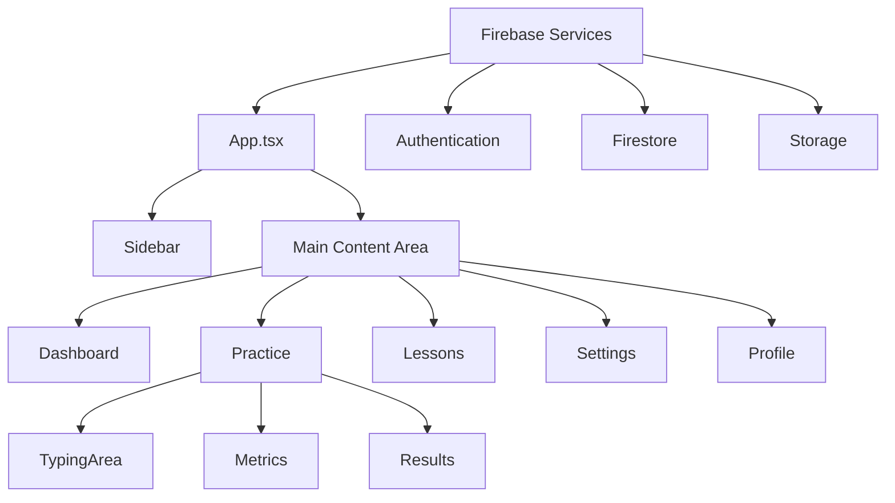

# Keyboard Master Brownfield Enhancement Architecture

**Version:** 1.0  
**Date:** November 24, 2024  
**Author:** Architect  
**Status:** Active  

---

## Introduction

This document outlines the architectural approach for enhancing Keyboard Master with comprehensive architectural documentation and future enhancement planning. Its primary goal is to serve as the guiding architectural blueprint for AI-driven development of new features while ensuring seamless integration with the existing system.

**Relationship to Existing Architecture:**
This document supplements existing project architecture by defining how new components will integrate with current systems. Where conflicts arise between new and existing patterns, this document provides guidance on maintaining consistency while implementing enhancements.

## Existing Project Analysis

Based on my analysis of your project, I've identified the following about your existing system:

### Current Project State

- **Primary Purpose:** Comprehensive typing practice application with real-time feedback, multiple practice modes, and progress tracking
- **Current Tech Stack:** React 18 + TypeScript, Vite build tool, Tailwind CSS, Firebase backend (Auth, Firestore, Storage), React Router DOM
- **Architecture Style:** Component-based React architecture with feature-based organization, unidirectional data flow, and Firebase as backend-as-a-service
- **Deployment Method:** Firebase Hosting or Vercel with modern build pipeline

### Available Documentation

- Comprehensive PRD with detailed functional requirements, user personas, and technical specifications
- Well-structured package.json with clear dependencies
- README with setup instructions and Firebase configuration guide

### Identified Constraints

- Firebase dependency for backend services (authentication, database, storage)
- Browser-based application limitations for real-time features
- Single-page application architecture with client-side routing
- Mobile-responsive design requirements
- Performance constraints for real-time typing metrics

## Change Log

| Change | Date | Version | Description | Author |
|--------|------|---------|-------------|--------|
| Initial architecture documentation | 2024-11-24 | 1.0 | Created comprehensive brownfield architecture for Keyboard Master | Architect |

## Enhancement Scope and Integration Strategy

### Enhancement Overview

**Enhancement Type:** Comprehensive architectural documentation and foundation for future enhancements
**Scope:** Complete system architecture documentation with integration guidelines for future features
**Integration Impact:** Foundation-level - establishes patterns and guidelines for all future development

### Integration Approach

**Code Integration Strategy:** Maintain existing component-based architecture while establishing clear patterns for new feature integration
**Database Integration:** Continue with Firebase Firestore while establishing data modeling guidelines
**API Integration:** Firebase-first approach with clear patterns for external API integration
**UI Integration:** Maintain Tailwind CSS consistency with established component library patterns

### Compatibility Requirements

- **Existing API Compatibility:** Maintain all current Firebase integration patterns
- **Database Schema Compatibility:** Ensure all new data models extend existing user document structure
- **UI/UX Consistency:** Follow established design patterns and component structure
- **Performance Impact:** Maintain sub-50ms typing latency with new features

## Tech Stack

### Existing Technology Stack

| Category | Current Technology | Version | Usage in Enhancement | Notes |
|----------|-------------------|---------|---------------------|-------|
| Frontend Framework | React | 18.3.1 | Core foundation for all new features | Maintain React 18 patterns |
| Language | TypeScript | 5.6.3 | Type safety for all new code | Strict type checking required |
| Build Tool | Vite | 5.4.10 | Build system for enhanced features | Maintain fast development experience |
| Styling | Tailwind CSS | 3.4.13 | UI consistency for new components | Follow existing design system |
| State Management | React Hooks | Built-in | Local state management patterns | Consider Context API for global state |
| Routing | React Router DOM | 7.9.6 | Navigation for new pages | Maintain existing route structure |
| Authentication | Firebase Auth | 10.14.1 | User management for new features | Extend existing auth patterns |
| Database | Firebase Firestore | 10.14.1 | Data persistence for new features | Follow existing document structure |
| Hosting | Firebase Hosting | - | Deployment platform | Maintain existing deployment pipeline |

### New Technology Additions

No new technologies required for architectural documentation. Future enhancements may require additional technologies based on specific requirements.

## Data Models and Schema Changes

### New Data Models

No new data models required for architectural documentation. Future enhancements will follow these patterns:

#### User Data Model Extension Pattern
**Purpose:** Establish consistent pattern for extending user data
**Integration:** Extend existing user document structure in Firestore

**Key Attributes:**
- `userId`: string - Firebase Auth UID (existing)
- `profile`: object - User profile information (existing)
- `progress`: object - Learning progress data (existing)
- `settings`: object - User preferences (existing)
- `stats`: object - Performance statistics (existing)

**Relationships:**
- **With Existing:** Maintains compatibility with current user document structure
- **With New:** All new user-related features will extend this pattern

### Schema Integration Strategy

**Database Changes Required:**
- **New Tables:** None for architectural documentation
- **Modified Tables:** User document may be extended for new features
- **New Indexes:** To be determined based on specific feature requirements
- **Migration Strategy:** Gradual schema evolution with backward compatibility

**Backward Compatibility:**
- All existing user data remains unchanged
- New fields are optional with default values
- API responses maintain existing structure
- Progressive enhancement approach for new features

## Component Architecture

### New Components

No new components required for architectural documentation. Future components will follow these patterns:

#### Component Organization Pattern
**Responsibility:** Establish consistent component structure and organization
**Integration Points:** Follow existing feature-based folder structure

**Key Interfaces:**
- Props interfaces with TypeScript
- Event handler patterns
- State management approaches
- Lifecycle management

**Dependencies:**
- **Existing Components:** Reuse established UI components
- **New Components:** Follow established patterns for consistency

**Technology Stack:** React 18 + TypeScript + Tailwind CSS

### Component Interaction Diagram



## API Design and Integration

### API Integration Strategy

**API Integration Strategy:** Firebase-first approach with RESTful patterns for external integrations
**Authentication:** Firebase Auth with JWT token management
**Versioning:** Semantic versioning for API changes

### New API Endpoints

No new API endpoints required for architectural documentation. Future endpoints will follow these patterns:

#### Firebase Integration Pattern
- **Method:** Varies by operation
- **Endpoint:** Firebase Firestore collections
- **Purpose:** Data persistence and retrieval
- **Integration:** Follow existing Firebase service patterns

**Request:**
```json
{
  "collection": "users",
  "document": "userId",
  "data": {
    "field": "value"
  }
}
```

**Response:**
```json
{
  "success": true,
  "data": {
    "field": "value"
  }
}
```

## Source Tree

### Existing Project Structure

```
keyboard-master/
├── src/
│   ├── components/          # Reusable UI components
│   │   ├── Charts/         # Chart components
│   │   ├── Metrics.tsx     # Performance metrics display
│   │   ├── Results.tsx     # Results modal
│   │   └── TypingArea.tsx  # Main typing interface
│   ├── hooks/              # Custom React hooks
│   ├── lib/                # Utility libraries
│   │   └── firebase.ts     # Firebase configuration
│   ├── pages/              # Page components
│   │   ├── Dashboard.tsx   # Main dashboard
│   │   ├── Practice.tsx    # Practice modes
│   │   └── Settings.tsx    # Settings page
│   ├── styles/             # Global styles
│   ├── types/              # TypeScript type definitions
│   └── utils/              # Utility functions
├── docs/                   # Documentation
├── package.json            # Dependencies and scripts
└── vite.config.ts         # Build configuration
```

### New File Organization

For future enhancements, follow this pattern:

```
keyboard-master/
├── src/
│   ├── components/          # Existing components
│   │   ├── Charts/         # Existing chart components
│   │   ├── Metrics.tsx     # Existing metrics
│   │   ├── Results.tsx     # Existing results
│   │   ├── TypingArea.tsx  # Existing typing area
│   │   └── NewFeature/     # New feature components
│   │       ├── Component1.tsx
│   │       └── Component2.tsx
│   ├── hooks/              # Existing hooks
│   │   └── useNewFeature.ts # New feature hooks
│   ├── lib/                # Existing libraries
│   │   └── newFeature.ts   # New feature utilities
│   ├── pages/              # Existing pages
│   │   └── NewFeature.tsx  # New feature page
│   ├── types/              # Existing types
│   │   └── newFeature.ts   # New feature types
│   └── utils/              # Existing utilities
│       └── newFeature.ts   # New feature utilities
```

### Integration Guidelines

- **File Naming:** PascalCase for components, camelCase for utilities
- **Folder Organization:** Feature-based organization with clear separation of concerns
- **Import/Export Patterns:** Use index files for clean imports, maintain consistent export patterns

## Infrastructure and Deployment Integration

### Existing Infrastructure

**Current Deployment:** Firebase Hosting with Vite build pipeline
**Infrastructure Tools:** Firebase (Auth, Firestore, Storage, Hosting)
**Environments:** Development (localhost), Production (Firebase Hosting)

### Enhancement Deployment Strategy

**Deployment Approach:** Continue with Firebase Hosting, maintain existing CI/CD patterns
**Infrastructure Changes:** Minimal - leverage existing Firebase infrastructure
**Pipeline Integration:** Extend existing build process for new features

### Rollback Strategy

**Rollback Method:** Firebase Hosting rollback capabilities
**Risk Mitigation:** Feature flags for gradual rollout
**Monitoring:** Firebase Analytics and error tracking

## Coding Standards

### Existing Standards Compliance

**Code Style:** TypeScript with strict type checking, ESLint configuration
**Linting Rules:** ESLint with React and TypeScript rules
**Testing Patterns:** Jest and React Testing Library (configured but not fully implemented)
**Documentation Style:** JSDoc comments for complex functions

### Enhancement-Specific Standards

No new standards required for architectural documentation. Future enhancements will follow:

- **TypeScript Strict Mode:** All new code must pass strict type checking
- **Component Documentation:** JSDoc comments for all component props
- **Error Handling:** Consistent error boundary implementation
- **Performance:** React.memo and useMemo for expensive operations

### Critical Integration Rules

- **Existing API Compatibility:** Maintain all existing Firebase integration patterns
- **Database Integration:** Extend existing user document structure, don't replace
- **Error Handling:** Use existing error handling patterns and Firebase error codes
- **Logging Consistency:** Follow existing console logging patterns for debugging

## Testing Strategy

### Integration with Existing Tests

**Existing Test Framework:** Jest and React Testing Library (configured)
**Test Organization:** Co-located with components (recommended pattern)
**Coverage Requirements:** Target 80% coverage for new features
**Integration with Existing:** Follow existing test patterns and naming conventions

### New Testing Requirements

#### Unit Tests for New Components
- **Framework:** Jest + React Testing Library
- **Location:** `__tests__` folders or `.test.tsx` files
- **Coverage Target:** 80% for new components
- **Integration with Existing:** Follow existing test patterns

#### Integration Tests
- **Scope:** Feature integration with Firebase services
- **Existing System Verification:** Ensure existing functionality remains intact
- **New Feature Testing:** End-to-end testing for new features

#### Regression Testing
- **Existing Feature Verification:** Automated tests for all existing features
- **Automated Regression Suite:** Comprehensive test suite for CI/CD
- **Manual Testing Requirements:** User acceptance testing for major features

## Security Integration

### Existing Security Measures

**Authentication:** Firebase Auth with Google OAuth and email/password
**Authorization:** Firestore security rules for user data access
**Data Protection:** HTTPS encryption for all data transmission
**Security Tools:** Firebase security monitoring and alerts

### Enhancement Security Requirements

**New Security Measures:** Follow existing Firebase security patterns
**Integration Points:** Ensure all new features respect existing security rules
**Compliance Requirements:** GDPR compliance for user data handling

### Security Testing

**Existing Security Tests:** Firebase security rules testing
**New Security Test Requirements:** Security testing for all new features
**Penetration Testing:** Regular security audits for production deployment

## Next Steps

### Story Manager Handoff

Create a brief prompt for Story Manager to work with this brownfield enhancement. Include:
- Reference to this architecture document
- Key integration requirements validated with user
- Existing system constraints based on actual project analysis
- First story to implement with clear integration checkpoints
- Emphasis on maintaining existing system integrity throughout implementation

### Developer Handoff

Create a brief prompt for developers starting implementation. Include:
- Reference to this architecture and existing coding standards analyzed from actual project
- Integration requirements with existing codebase validated with user
- Key technical decisions based on real project constraints
- Existing system compatibility requirements with specific verification steps
- Clear sequencing of implementation to minimize risk to existing functionality

---

*This document is a living architecture guide and will be updated as the system evolves and new requirements emerge. All stakeholders should review and understand the architectural patterns before proceeding with development.*