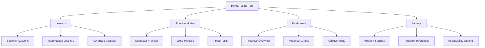
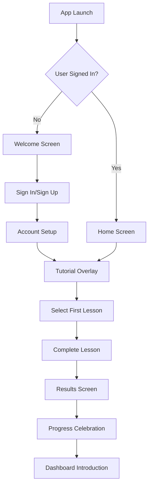
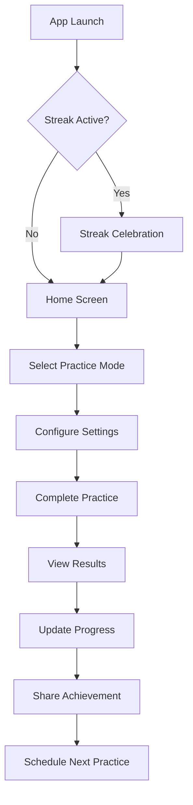
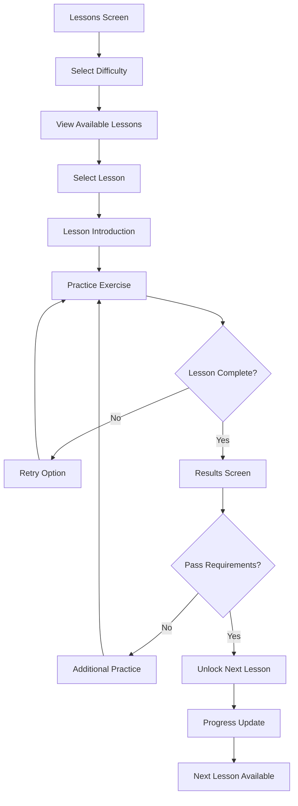

# Keyboard Master UI/UX Specification

This document defines user experience goals, information architecture, user flows, and visual design specifications for Keyboard Master's user interface. It serves as foundation for visual design and frontend development, ensuring a cohesive and user-centered experience.

## Overall UX Goals & Principles

### Target User Personas

1. **Beginner Learner:** New to typing practice, needs structured lessons and clear guidance
   - Motivation: Improve typing speed for school/work
   - Pain points: Don't know where to start, get frustrated with errors
   - Goals: Learn proper finger placement, build muscle memory

2. **Skill Builder:** Has basic typing skills, wants to improve speed and accuracy
   - Motivation: Career advancement, personal productivity
   - Pain points: Plateau in progress, inconsistent practice
   - Goals: Increase WPM, reduce errors, maintain consistency

3. **Typing Enthusiast:** Advanced user seeking mastery and challenges
   - Motivation: Personal achievement, competitive spirit
   - Pain points: Limited challenging content, lacks detailed analytics
   - Goals: Achieve high WPM, master complex texts, track detailed progress

### Usability Goals

- Ease of learning: New users can complete core tasks within 5 minutes
- Efficiency of use: Power users can complete frequent tasks with minimal clicks
- Error prevention: Clear validation and confirmation for destructive actions
- Memorability: Infrequent users can return without relearning
- Accessibility: All users can navigate and use the application regardless of ability

### Design Principles

1. **Clarity over cleverness** - Prioritize clear communication over aesthetic innovation
2. **Progressive disclosure** - Show only what's needed, when it's needed
3. **Consistent patterns** - Use familiar UI patterns throughout the application
4. **Immediate feedback** - Every action should have a clear, immediate response
5. **Accessible by default** - Design for all users from the start

## Information Architecture (IA)

### Site Map / Screen Inventory

### Navigation Structure

**Primary Navigation:** Bottom tab bar on mobile, left sidebar on desktop
- Home (Typing Test)
- Lessons
- Practice
- Dashboard
- Settings

**Secondary Navigation:** Contextual navigation within each section
- Lesson progression within Lessons
- Mode selection within Practice
- Time period filters within Dashboard

**Breadcrumb Strategy:** Simple linear breadcrumbs showing user's current location

## User Flows

### New User Onboarding Flow

**User Goal:** Successfully complete first typing lesson and understand app features

**Entry Points:** First app launch after installation

**Success Criteria:** User completes first lesson, understands basic navigation, feels motivated to continue

#### Flow Diagram

#### Edge Cases & Error Handling:
- Network connectivity issues during account creation
- Firebase configuration missing
- User skips tutorial
- User abandons lesson midway

#### Notes: Tutorial should be skippable but recommended for first-time users

### Daily Practice Flow

**User Goal:** Complete daily typing practice and track progress

**Entry Points:** App launch, notification reminder, direct widget access

**Success Criteria:** User completes practice session, sees progress update, motivated to return

#### Flow Diagram

#### Edge Cases & Error Handling:
- Practice interrupted by phone call/notification
- Network error during progress save
- Device storage full
- User achieves new personal record

#### Notes: Consider offline mode for practice without network connectivity

### Lesson Progression Flow

**User Goal:** Advance through structured lessons to improve typing skills

**Entry Points:** Lessons section, dashboard recommendations, automatic progression

**Success Criteria:** User understands progression path, can track advancement, feels sense of achievement

#### Flow Diagram

#### Edge Cases & Error Handling:
- User fails lesson multiple times
- User wants to skip ahead
- Progress data corruption
- User changes difficulty level

#### Notes: Implement adaptive difficulty based on performance

## Wireframes & Mockups

**Primary Design Files:** Figma designs to be created based on these specifications

### Key Screen Layouts

#### Home/Typing Test Screen

**Purpose:** Main typing interface with real-time feedback

**Key Elements:**
- Virtual keyboard overlay with finger positioning guides
- Text display area with character-by-character feedback
- Real-time metrics (WPM, accuracy, time)
- Progress bar showing completion percentage
- Settings quick access

**Interaction Notes:** 
- Keyboard highlights next character to type
- Visual feedback for correct/incorrect typing
- Smooth animations for transitions

**Design File Reference:** [Figma Frame: Home-Screen]

#### Lessons Screen

**Purpose:** Structured learning path with progression tracking

**Key Elements:**
- Lesson categories (Beginner, Intermediate, Advanced)
- Individual lesson cards with status indicators
- Progress overview for each category
- Difficulty selector
- Search/filter options

**Interaction Notes:**
- Clear visual indicators for completed/in-progress/locked lessons
- Smooth transitions between lesson categories
- Preview of lesson content before selection

**Design File Reference:** [Figma Frame: Lessons-Screen]

#### Dashboard Screen

**Purpose:** Comprehensive progress tracking and analytics

**Key Elements:**
- Historical WPM/accuracy charts
- Streak counter and calendar view
- Achievement badges and milestones
- Practice time statistics
- Personal records and comparisons

**Interaction Notes:**
- Interactive charts with different time ranges
- Expandable achievement details
- Social sharing options for milestones

**Design File Reference:** [Figma Frame: Dashboard-Screen]

#### Virtual Keyboard Overlay

**Purpose:** Visual guide for proper finger positioning and typing technique

**Key Elements:**
- Color-coded key groups for different fingers
- Highlighted next key to press
- Finger position indicators
- Show/hide toggle
- Adjustable transparency

**Interaction Notes:**
- Smooth highlighting transitions
- Visual feedback for key presses
- Customizable display options

**Design File Reference:** [Figma Frame: Virtual-Keyboard]

## Component Library / Design System

**Design System Approach:** Build on existing Tailwind CSS foundation with custom components for typing-specific interactions

### Core Components

#### TypingTextDisplay

**Purpose:** Display text with character-by-character feedback

**Variants:** 
- Standard mode (full text visible)
- Progressive mode (text reveals as user types)
- Focus mode (current word highlighted)

**States:**
- Default (untyped text)
- Correct (typed correctly)
- Incorrect (typed incorrectly)
- Current (next character to type)
- Upcoming (future characters)

**Usage Guidelines:** Use consistent color coding across all typing modes

#### VirtualKeyboard

**Purpose:** Interactive keyboard visualization for learning

**Variants:**
- Full QWERTY layout
- Simplified layout (showing only relevant keys)
- Finger position guide overlay

**States:**
- Default (all keys neutral)
- Highlighted (next key to press)
- Pressed (visual feedback for key press)
- Correct/Incorrect feedback

**Usage Guidelines:** Allow customization of visibility and transparency

#### ProgressIndicator

**Purpose:** Show completion status and progress

**Variants:**
- Linear progress bar
- Circular progress indicator
- Step-based progression

**States:**
- Active (currently in progress)
- Completed (successfully finished)
- Paused (temporarily stopped)
- Error (error state)

**Usage Guidelines:** Consistent visual language across all progress indicators

#### MetricsDisplay

**Purpose:** Real-time performance metrics

**Variants:**
- Compact (minimal display)
- Detailed (expanded with additional metrics)
- Historical (with trend indicators)

**States:**
- Live (updating in real-time)
- Final (completed session)
- Comparison (showing improvement/decline)

**Usage Guidelines:** Clear visual hierarchy with most important metrics prominent

## Branding & Style Guide

**Brand Guidelines:** Modern, clean, and motivating aesthetic focused on learning and achievement

### Color Palette

| Color Type | Hex Code | Usage |
|------------|-----------|-------|
| Primary | #007BFF | Primary actions, active states, links |
| Secondary | #6C757D | Secondary actions, inactive states |
| Accent | #28A745 | Success states, achievements, progress |
| Success | #28A745 | Positive feedback, confirmations |
| Warning | #FFC107 | Cautions, important notices |
| Error | #DC3545 | Errors, destructive actions |
| Neutral | #F8F9FA | Backgrounds, cards, containers |
| Text Primary | #212529 | Main text content |
| Text Secondary | #6C757D | Secondary text, captions |

### Typography

#### Font Families
- **Primary:** Inter (modern, highly readable sans-serif)
- **Secondary:** Roboto Mono (for code and typing displays)
- **Monospace:** JetBrains Mono (for typing practice areas)

#### Type Scale

| Element | Size | Weight | Line Height |
|----------|-------|--------|------------|
| H1 | 2.5rem | 700 | 1.2 |
| H2 | 2rem | 600 | 1.3 |
| H3 | 1.5rem | 600 | 1.4 |
| Body | 1rem | 400 | 1.5 |
| Small | 0.875rem | 400 | 1.4 |

### Iconography

**Icon Library:** Heroicons (consistent with Tailwind CSS)

**Usage Guidelines:** 
- Use consistent stroke width (2px)
- Maintain consistent sizing (16px, 20px, 24px)
- Clear visual hierarchy with size and color variations

### Spacing & Layout

**Grid System:** 12-column responsive grid with Tailwind CSS

**Spacing Scale:** 
- Base unit: 0.25rem (4px)
- Scale: 0.5rem (8px), 1rem (16px), 1.5rem (24px), 2rem (32px), 3rem (48px)

## Accessibility Requirements

### Compliance Target

**Standard:** WCAG 2.1 AA compliance

### Key Requirements

**Visual:**
- Color contrast ratios: 4.5:1 for normal text, 3:1 for large text
- Focus indicators: Visible 2px outline with high contrast
- Text sizing: Scalable up to 200% without loss of functionality

**Interaction:**
- Keyboard navigation: Full keyboard access to all interactive elements
- Screen reader support: Proper ARIA labels and semantic HTML
- Touch targets: Minimum 44x44px for touch interfaces

**Content:**
- Alternative text: Descriptive alt text for all meaningful images
- Heading structure: Proper h1-h6 hierarchy without skipping levels
- Form labels: Explicit labels associated with all form controls

### Testing Strategy

- Automated testing with axe-core
- Manual keyboard navigation testing
- Screen reader testing with VoiceOver and NVDA
- Color contrast validation with tools
- User testing with assistive technology users

## Responsiveness Strategy

### Breakpoints

| Breakpoint | Min Width | Max Width | Target Devices |
|------------|------------|------------|----------------|
| Mobile | 320px | 767px | Smartphones |
| Tablet | 768px | 1023px | Tablets, small laptops |
| Desktop | 1024px | 1439px | Laptops, desktops |
| Wide | 1440px | - | Large desktops |

### Adaptation Patterns

**Layout Changes:** 
- Mobile: Single column layout, bottom navigation
- Tablet: Two-column layout, side navigation
- Desktop: Multi-column layout, full sidebar

**Navigation Changes:** 
- Mobile: Bottom tab bar, hamburger menu for additional options
- Tablet: Side navigation with icons and labels
- Desktop: Full sidebar with text labels

**Content Priority:** 
- Mobile: Essential content first, progressive disclosure
- Tablet: Balanced content display
- Desktop: Full content visibility with optional details

**Interaction Changes:** 
- Mobile: Touch-optimized targets, swipe gestures
- Tablet: Mixed touch and pointer interactions
- Desktop: Pointer-optimized interactions, keyboard shortcuts

## Animation & Micro-interactions

### Motion Principles

- Purposeful: Every animation serves a functional purpose
- Responsive: Animation responds immediately to user input
- Efficient: Animations respect device capabilities and user preferences
- Accessible: Respect reduced motion preferences

### Key Animations

- **Key press feedback:** Visual highlight with 150ms duration, ease-out easing
- **Progress updates:** Smooth transitions over 300ms, ease-in-out easing
- **Screen transitions:** Slide transitions over 250ms, ease-out easing
- **Achievement unlocks:** Celebratory animation over 800ms, elastic easing
- **Error states:** Shake animation over 400ms, ease-in-out easing

## Performance Considerations

### Performance Goals

- **Page Load:** Initial content visible within 2 seconds on 3G
- **Interaction Response:** UI feedback within 100ms of user input
- **Animation FPS:** Maintain 60fps for all animations

### Design Strategies

- Optimize font loading with font-display: swap
- Use CSS transforms for animations (better performance than position changes)
- Implement lazy loading for non-critical components
- Minimize layout shifts with proper aspect ratio containers
- Use will-change property sparingly for animated elements

## Next Steps

### Immediate Actions

1. Create detailed Figma designs based on these specifications
2. Develop component library with core typing components
3. Implement responsive layouts for all screen sizes
4. Set up accessibility testing framework
5. Create user testing plan for validation

### Design Handoff Checklist

- [x] All user flows documented
- [x] Component inventory complete
- [x] Accessibility requirements defined
- [x] Responsive strategy clear
- [x] Brand guidelines incorporated
- [x] Performance goals established

## Implementation Priority

### Phase 1: Core Improvements (High Priority)
1. Virtual keyboard overlay with finger positioning
2. Enhanced visual feedback for typing
3. Improved mobile navigation
4. Basic progress tracking dashboard

### Phase 2: Advanced Features (Medium Priority)
1. Comprehensive analytics and historical data
2. Achievement system and gamification
3. Social features and sharing
4. Advanced accessibility features

### Phase 3: Polish & Optimization (Lower Priority)
1. Advanced animations and micro-interactions
2. Performance optimizations
3. Additional language support
4. Advanced customization options